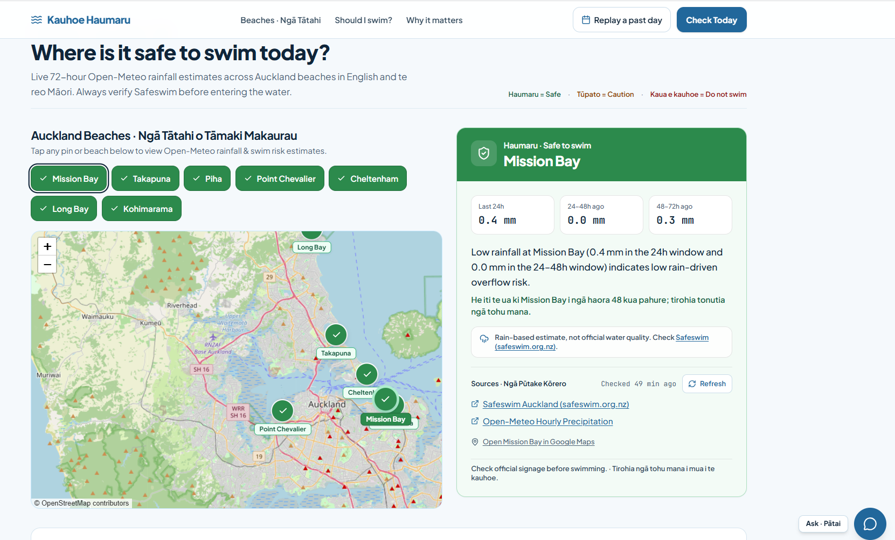
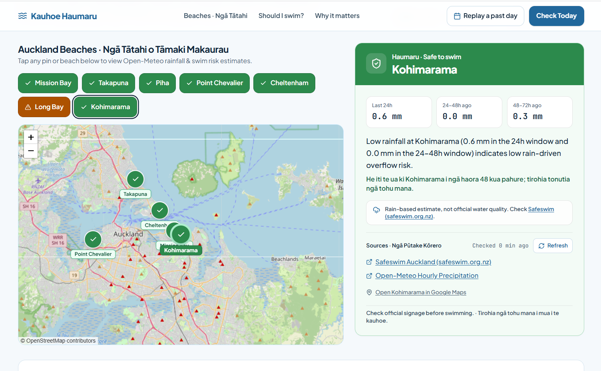
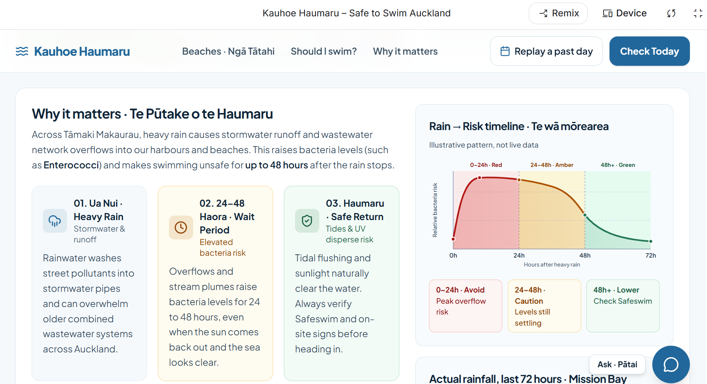

# Kauhoe Haumaru: Safe to Swim Auckland

**Kauhoe Haumaru** means "safe swimming" in te reo Māori. It is a mobile-friendly web app that helps Aucklanders decide where it is safe to swim today.

Built in Google AI Studio during the vibe coding session at **DevFest Auckland 2026** (AUT, 21 November 2026).



## The problem

After heavy rain in Tāmaki Makaurau, stormwater runoff and wastewater overflows wash into harbours and beaches. Bacteria levels can stay high for up to 48 hours, even when the sun is out and the water looks clear. The advice exists, but most swimmers don't know to check it.

## What the app does

- **Beach map:** seven popular Auckland beaches (Mission Bay, Takapuna, Piha, Point Chevalier, Cheltenham, Long Bay, Kohimarama) shown with Green / Amber / Red swim status.
- **Check Today:** one click checks every beach in turn and colours the map and beach buttons.
- **Beach status cards:** a clear status, a plain-English reason, a te reo Māori summary and source links.
- **"Should I swim?" chat:** ask questions such as "Is it safe to swim at Takapuna after yesterday's rain?" and get an answer grounded in search results, with sources.
- **Rain to risk timeline:** an illustrative chart showing how risk rises after heavy rain and falls back after about 48 hours.
- **Bilingual labels:** Haumaru (Safe), Tūpato (Caution), Kaua e kauhoe (Do not swim).

## Designed to fail safely

For a safety app, being wrong is worse than saying "I don't know". The app was built so it never presents a guess as live data:

- **Caching:** results are cached for 30 minutes on the server and in the browser, and duplicate requests are blocked, to protect API quota.
- **Map fallback:** if Google Maps is unavailable or over quota, the map switches automatically to Leaflet with OpenStreetMap tiles.
- **Demo mode:** if Gemini is unavailable, the app switches to clearly labelled sample data, with a "Demo mode: sample data, not live conditions" banner and a "Sample result" tag on every card.
- **Neutral errors:** a failed check shows a grey "Live check unavailable" card with a link to [Safeswim](https://www.safeswim.org.nz). Red is only ever used to mean "Do not swim".
- **Disclaimer:** "Check official signage before swimming" appears throughout.

## Built with

- Google AI Studio (Build mode)
- Gemini API with Google Search grounding (beach status and chat)
- Google Maps Platform: Maps JavaScript API via `@vis.gl/react-google-maps`
- Leaflet and OpenStreetMap (fallback map)
- React, TypeScript, Vite and Tailwind CSS
- Node.js / Express server (`server.ts`) for API calls and caching

## Run locally

1. Clone the repository and install dependencies:
   ```bash
   npm install
   ```
2. Create a `.env` file and add your own keys (never commit real keys):
   ```
   GEMINI_API_KEY=your_gemini_api_key
   ```
   A Google Maps API key is optional. Without one, the app uses the OpenStreetMap fallback.
3. Start the app:
   ```bash
   npm run dev
   ```

Without a working Gemini key, the app runs in Demo mode with sample data.

## Screenshots

| Beach map | Status card | Rain to risk timeline |
|---|---|---|
|  |  |  |

## Related work

This app builds on my earlier **MINZ 2026 Safe to Swim** project, a machine learning model predicting swim safety on the Oroua River.

## Disclaimer

This is a prototype built at a hackathon. It is not an official source of water quality information. Always check [Safeswim](https://www.safeswim.org.nz) and on-site signage before swimming.

## Author

**Jannathul Firdouz**, Data Analyst, Master of Analytics (AUT)
[GitHub](https://github.com/jannathulfirdouz)
